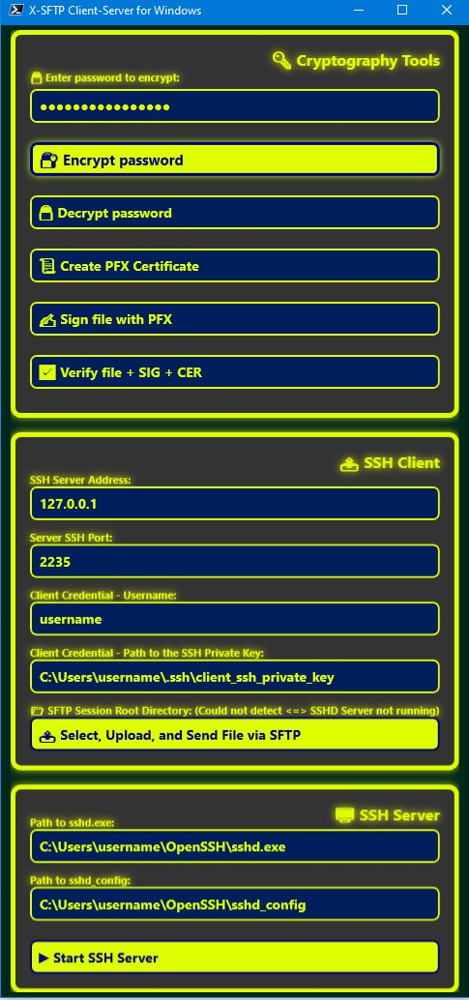

📄 README.md
# Extended SFTP Client-Server for Windows

[](https://learn.microsoft.com/powershell/)
[](https://www.microsoft.com/windows)
[](LICENSE)
[](https://github.com/PrzemyslawZabicki/x-sftp-client-server-win/stargazers)
[](https://github.com/PrzemyslawZabicki/x-sftp-client-server-win/issues)

### Windows-based PowerShell GUI application that provides secure file transfer and cryptographic operations.  
#### This project combines **SFTP client/server functionality** with **encryption, signing, certificate management, and SSH server control**.

## ⚡ Quick Start

Follow these steps to launch the application quickly:

1. **Clone the repository**
   ```bash
   git clone https://github.com/PrzemyslawZabicki/x-sftp-client-server-win.git
   cd x-sftp-client-server-win

2. **Run the PowerShell script**
   ```powershell
   .\X-SFTP-Client-Server.ps1

3. **Configure the GUI**
   - 🔑 Enter a password for encryption/decryption.  
   - 📜 Set paths for certificates (`.pfx`, `.cer`).  
   - 📤 Configure SSH Client settings (host, port, username, private key).  
   - 🖥️ Configure SSH Server settings (path to `sshd.exe` and `sshd_config`).  

4. **Start the SSH Server**
   - Click **▶ Start SSH Server**.  
   - The server runs with flags `-D -ddd -f <configPath>`.  
   - Logs stream live to the **console** and are saved to `%USERPROFILE%\sshd_run.log`.  

5. **Transfer Files**
   - Use the **Upload File via SFTP** button to send files to the configured server.  
   - The server panel shows the root directory for incoming files.  

## 💡 Features

1. **🔐 Password Encryption**  
   AES-256 encryption for user passwords and configuration files.  

2. **🔓 Password Decryption**  
   Decrypt stored configuration files and passwords.  

3. **📜 Create X.509 Certificates**  
   Generate self-signed certificates with customizable attributes.  

4. **✍️ File Signing**  
   Sign files using `.pfx` certificates (private key).  

5. **📝 Signature Verification**  
   Verify files using `.cer` certificates (public key).  

6. **📤 SFTP Client**  
   Upload selected files to a remote SSH server.  

7. **📥 SFTP Server**  
   Receive files from SFTP client over SSH.  

8. **🖥️ SSH Server Control**  
   Start an SSH server (`sshd.exe`) with custom configuration (`sshd_config`) directly from the GUI.  
   - Runs with flags `-D -ddd -f <configPath>`  
   - Logs output both to **console** and to a **file** (`%USERPROFILE%\sshd_run.log`).  

## 🖥️ GUI Overview

The application uses a WPF-based interface with neon-styled panels and buttons for:

1. **Encrypt / Decrypt password & config.json**  
2. **Create PFX Certificate**  
3. **Sign file with PFX**  
4. **Verify file with CER**  
5. **Configure SFTP Client settings (host, port, user, key)**  
6. **Upload files via SFTP**  
7. **Run SSH Server (sshd.exe + sshd_config)**  

---

## 📡 Live Logging

When starting the SSH server via the **Run SSH Server** button:

- The application executes `sshd.exe -D -ddd -f <configPath>` using the paths provided in the GUI.  
- Output from the SSH daemon is **streamed live**:
  - 🖥️ **Console** - logs appear in real time in the PowerShell host window.  
  - 📂 **File**    - logs are appended to `%USERPROFILE%\sshd_run.log` with timestamps.  

**Example log snippet:**

[2025-11-19 01:30:12] SSHD run output:
debug1: sshd version OpenSSH_9.7, OpenSSL 3.0.12
debug3: sshd_config file found at C:\Users\<User>\OpenSSH-Win64\sshd_config
debug2: listening on 127.0.0.1 port 2235

## 🛠️ Troubleshooting

When running the SSH server with `-D -ddd -f <configPath>`, the daemon prints detailed debug logs.  
Here are some common messages and what they mean:

1. **`debug1: sshd version OpenSSH_X.Y`**  
   Confirms the SSH daemon started and shows version.  
   *Fix:* No action needed.  

2. **`debug1: read configuration data <path>`**  
   Indicates the config file is being parsed.  
   *Fix:* Verify the path is correct and accessible.  

3. **`Bad configuration option: XYZ`**  
   The config file contains an invalid directive.  
   *Fix:* Remove or correct the option in `sshd_config`.  

4. **`Could not load host key: ...`**  
   SSH server cannot find or read the host key file.  
   *Fix:* Ensure host keys exist in the specified directory and have correct permissions.  

5. **`Bind to port 2235 on 127.0.0.1 failed: Permission denied`**  
   The server tried to bind to a privileged port without admin rights.  
   *Fix:* Run PowerShell as Administrator or use a non‑privileged port (e.g., >1024).  

6. **`Server listening on :: port 2235`**  
   Confirms the server is successfully listening for connections.  
   *Fix:* No action needed.  

7. **`Connection closed by authenticating user`**  
   Client disconnected during authentication.  
   *Fix:* Check credentials, key paths, and permissions.  

---

## 📸 Screenshots

**Application GUI interface:**



---

## 🗂️ Application Workflow Diagram

```text
+-------------------------------------------------------------+
| 🔑 Cryptography Tools                                       |
|  - Encrypt / Decrypt password & config.json                 |
|  - Create PFX Certificate                                   |
|  - Sign / Verify files                                      |
+-------------------------------------------------------------+

+---------------------------+   +-----------------------------+
| 📤 SSH Client             |   | 🖥️ SSH Server               |
|  - Configure host, port   |   |  - Path to sshd.exe         |
|  - Username, private key  |   |  - Path to sshd_config      |
|  - Upload files via SFTP  |   |  - ▶ Start SSH Server       |
|                           |   |  - Live logging to console  |
|                           |   |    and file                 |
+---------------------------+   +-----------------------------+

## 📂 Project Structure

```text
.
├── .cert/                     # Generated certificates
├── config.enc                 # Encrypted configuration
├── x509-cert-config.json      # Certificate configuration
├── X-SFTP-Client-Server.ps1   # Main PowerShell script
└── README.md                  # Documentation

## 🛠️ Requirements

1. **Operating System**  
   - Windows 10/11  

2. **PowerShell**  
   - PowerShell 5.1+ or PowerShell Core  

3. **Modules**  
   - Microsoft.PowerShell.SecretManagement  
   - Microsoft.PowerShell.SecretStore  

---

## 📜 License

This project is licensed under the **MIT License**.  
See the [LICENSE](LICENSE) file for details.

---

## 🤝 Contributing

Pull requests are welcome!  
For major changes, please open an issue first to discuss what you would like to change.

---

## 📧 Contact

Created by **Przemyslaw Zabicki**  
Feel free to reach out via [GitHub Issues](https://github.com/PrzemyslawZabicki/x-sftp-client-server-win/issues).